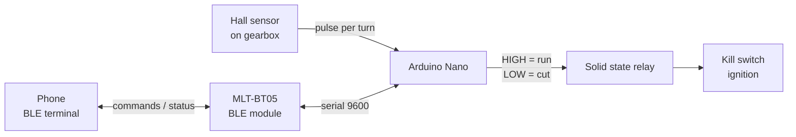
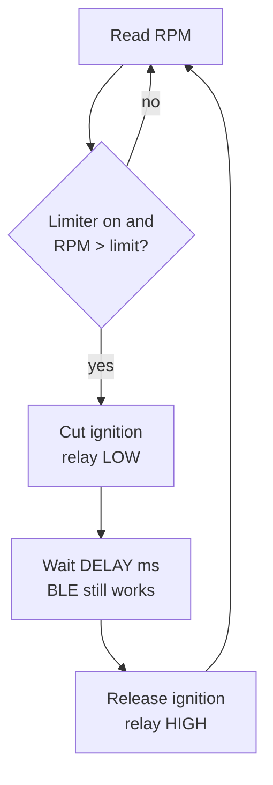

# Aprilia Limiter

RPM limiter for the 2-stroke **Aprilia RS4 50** moped.

A Hall sensor on the gearbox measures rotation speed. When it goes over the set limit, an Arduino Nano briefly cuts the ignition through a solid state relay on the kill switch. Settings are changed from a phone over Bluetooth LE and are kept after power-off.

## How it works



Each sensor pulse gives one rotation. RPM is calculated from the time between pulses:



- Pulses closer than 2 ms apart (over 30,000 rpm) are treated as noise and ignored.
- If no pulse arrives for 0.5 s, RPM is taken as 0.

## Hardware

| Part | Purpose |
|---|---|
| Arduino Nano | Main controller |
| Hall sensor + magnet | Reads rotation from the gearbox |
| MLT-BT05 (BLE) | Receives commands from the phone |
| Solid state relay | Opens the kill switch circuit to cut ignition |

### Wiring

| Nano pin | Connects to |
|---|---|
| D2 | Hall sensor output (internal pull-up enabled) |
| D4 | BLE module TX |
| D3 | BLE module RX |
| A1 | Solid state relay input |
| D13 (built-in LED) | Lights while ignition is cut (debug mode only) |

## Bluetooth commands

Connect with any BLE serial terminal app. Send each command followed by a newline (`\n`). After each command the board replies with the current settings.

| Command | Description |
|---|---|
| `TOGGLE_LIMIT` | Turn the limiter on/off |
| `TOGGLE_DEBUG` | Turn debug output on/off (sends the RPM on every cut) |
| `RPM_<value>` | Set the RPM limit, e.g. `RPM_6500`. Allowed range: 100–20000 |
| `DELAY_<value>` | Set how long the ignition is cut each time the limit is exceeded, in ms, e.g. `DELAY_20`. Allowed range: 0–2000 |

Example reply:

```
Debug 0
RPM 6500
Delay 20
Limiter 1
```

`RPM` and `DELAY` are saved to EEPROM. `TOGGLE_LIMIT` and `TOGGLE_DEBUG` are not saved: after power-on the limiter is always **on** and debug is **off**.

On first start (empty EEPROM) the defaults are **6000 rpm** and **20 ms**.

## Building

1. Open `Moped/Moped.ino` in the Arduino IDE.
2. Select board **Arduino Nano** (ATmega328P).
3. Upload.

## Notes

- The sensor is on the gearbox, so the limit applies to gearbox speed rather than crankshaft RPM.
- The BLE module uses SoftwareSerial, which pauses interrupts while sending or receiving. Heavy BLE traffic can make RPM readings slightly jumpy.
